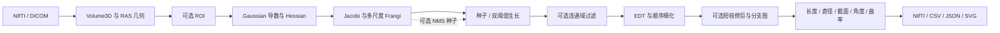

# 架构与 C++ 接口

## 调用关系



评价程序在主处理之外读入预测与参考；参考标签不进入普通 `medvessel_cli`。
开发辅助程序 `medvessel_prepare_case` 会使用参考标签选择 ROI/种子，复现脚本明确记录这一点。
基础滤波/重采样提供库接口，但主 CLI 不自动执行重采样或额外预平滑；Hessian 自身含 Gaussian 导数卷积。

## 代码组织

Qt 桌面入口在 `app/gui`。当前通过异步 QProcess 调用独立 CLI，以 NIfTI/CSV/JSON/SVG 为数据接口，核心算法不依赖 Qt。
JobConfig 负责 GUI 配置与索引换算，AnalysisJob 负责进程和任务状态，MainWindow 负责交互与展示。详细契约见 [桌面工作台](gui.md)。

| 位置 | 职责 |
| --- | --- |
| include/core | 连续体素存储、几何、裁剪、重采样、合成管生成 |
| include/filters | Gaussian、校正导数核、Hessian、Jacobi、Frangi |
| include/segmentation | NMS、区域生长、双阈值传播、连通域 |
| include/skeleton | 精确 EDT、simple-point 细化、图压缩、短枝修剪 |
| include/geometry | 长度、局部方向、截面、曲率、评价指标 |
| include/io + src/io | 影像读写接口、格式适配、参数、CSV/SVG 输出 |
| app | 主程序、生成器、评价、参考辅助 ROI、导出与内存演示 |
| tests | 数值/拓扑测试、CLI 合成全流程与下载完整性测试 |
| benchmarks | 单/多线程增强对照 |
| tools | 有界下载、转换、复现、独立绘图 |

核心当前主要是头文件实现，`medvessel` 为 CMake INTERFACE target。
`medvessel_io` 封装 NIfTI，`medvessel_dicom` 封装可选 DCMTK。
外部格式库不替代核心滤波、分割或骨架算法；Python 不在 C++ 主算法执行路径中。

## 数据与坐标契约

`Volume3D<T>` 的 dimensions 顺序为 x/y/z，内存偏移为 `(z*height+y)*width+x`。
`at(x,y,z)` 检查边界；构造时检查正尺寸和尺寸乘积溢出。
几何包括正 spacing、origin、按行存储的正交 direction，可包含反射，拒绝剪切。

```text
world = origin + direction × (index ⊙ spacing)
index = (directionᵀ × (world − origin)) ⊘ spacing
```

影像适配层统一到 RAS 毫米。连续索引用于插值，种子索引为零基整数。
ROI 的新 origin 是原图 start 索引对应的物理点，spacing/direction 不变。
重采样由调用者显式给出目标几何与尺寸；连续灰度用 linear，标签用 nearest。

## 主要接口

接口均位于 `medvessel` 命名空间；以下省略默认参数，完整签名以对应头文件为准。

| 接口 | 头文件 | 输出/契约 |
| --- | --- | --- |
| ImageGeometry::indexToWorld / worldToIndex | core/Volume3D.hpp | 连续索引与物理坐标双向变换 |
| cropVolume | core/Crop.hpp | 裁剪且保持物理位置 |
| resampleLinear / resampleNearest | core/Resample.hpp | 显式目标网格，范围外常量填充 |
| gaussianFilter3D | filters/Gaussian.hpp | 毫米 sigma，复制边界 |
| hessian3D | filters/Hessian.hpp | xx/xy/xz/yy/yz/zz 六个 Volume，默认 sigma² 归一化 |
| eigenSymmetric3x3 | filters/EigenSolver.hpp | 按绝对值升序的特征值及配对向量 |
| frangi3D | filters/Frangi.hpp | VesselnessResult：vesselness、bestScaleMm |
| nonMaximumSuppression3D | segmentation/Nms.hpp | 用于选种子的局部极大响应图 |
| seededRegionGrowing3D / hysteresisThreshold3D | segmentation/RegionGrowing.hpp | uint8 二值 Mask；要求输入网格一致 |
| connectedComponents3D / removeSmallComponents | segmentation/ConnectedComponents.hpp | uint32 标签/计数，或过滤后的二值 Mask |
| distanceTransform3D | skeleton/DistanceTransform.hpp | 到体积内背景中心的 mm 距离 |
| isSimplePoint26 / thinning3D | skeleton/Thinning.hpp | 前景 26、背景 6 的顺序拓扑保持侵蚀基线 |
| centerlineGraph | skeleton/CenterlineGraph.hpp | 节点、分支、世界坐标路径；闭环以自环表示 |
| pruneShortBranches | skeleton/Prune.hpp | 显式终末支修剪；保留完整孤立支和环路 |
| polylineLengthMm / branchAngleDegrees | geometry/BranchAnalysis.hpp | 物理长度与局部拟合出射夹角 |
| crossSection / polylineCurvature | geometry/CrossSection.hpp | 采样截面与离散曲率 |
| dice / hausdorff95Mm / clDice | segmentation/RegionGrowing.hpp、geometry/Evaluation.hpp | 要求明确参考与评价范围 |
| readNifti / writeNifti | io/Nifti.hpp | float 标量 Volume；写出 NIfTI-1 |
| readDicomSeries | io/DicomSeries.hpp | 经典单帧 CT → RAS/mm/HU |

`VesselNode` 保存代表位置和相邻分支 ID；`VesselBranch` 保存两端节点 ID、体素路径、世界坐标路径和长度。
图未指定根，节点编号与分支编号是当前提取结果中的零基序号，不应跨运行视为稳定解剖标识。

## 数值、内存与并行

灰度和响应主要存为 float，几何与特征值计算主要使用 double。
Hessian 同时保存六个 float 分量，滤波还需要中间 Volume；全体积计算有明显内存开销，目前未实现流式分块。
多尺度逐尺度处理，响应相同时保留先得到的尺度；无响应位置的尺度为 0。
启用 OpenMP 后只并行独立卷积切片，各体素的累加顺序不变；细化删除仍按顺序重新检查邻域。
异常通过标准 C++ exception 上报，CLI 捕获后写 stderr 并返回 1。

新增算法应先建立小体积数值/几何真值或拓扑反例，再接入 CLI。
算法约定、边界条件和限制见 [algorithms.md](algorithms.md)，验证范围见 [validation.md](validation.md)。
