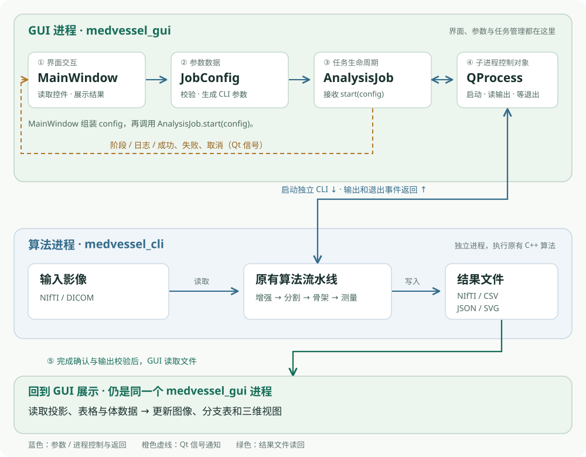

# Qt 工作台是怎么写出来的

新增功能说明：三方向原网格切片、窗宽窗位、Mask 叠加、鼠标点选与框选、VTK 三维联动与结果切片定位已接入，具体实现见本文末尾第 17～21 节；前文的投影调用链仍保留。

这篇讲实现思路和代码，使用步骤见 [桌面操作手册](gui.md)。不要求你先学完 Qt：有基本 C++ 类、函数、指针和 lambda 知识，就可以从这里开始。
先读前四节，建立整体画面；随后跟着一次“开始分析”读实现；最后通过小练习修改界面。代码片段用于讲解，省略部分会明确标出，完整实现以源码为准。

## 1. 先记住：一个窗口、一个任务管理器、一个算法进程

桌面版有三个主要类，另有应用入口：

| 位置 | 可以怎样理解 | 负责什么 |
| --- | --- | --- |
| [main.cpp](../app/gui/main.cpp) | 开门并让应用持续工作 | 创建 QApplication、窗口、命令行选项，进入事件循环 |
| [MainWindow](../app/gui/MainWindow.hpp) | 操作台 | 创建控件、读取填写值、显示图像和表格、响应操作 |
| [JobConfig](../app/gui/JobConfig.hpp) | 一张任务参数表 | 保存值、转成 CLI 参数、校验、JSON 往返 |
| [AnalysisJob](../app/gui/AnalysisJob.hpp) | 任务管理员 | 启动/停止进程、读取日志、通知阶段、记录最终状态 |
| [pipeline.cpp](../app/pipeline.cpp) | 算法执行入口 | 运行原有 C++ 增强、分割、骨架和测量流程 |



核心点：GUI 传递参数，CLI 执行算法，文件保存结果。GUI 没有在按钮回调中直接计算 Frangi，也没有重新实现一份血管算法。
当前这条链路不用 QThread；QProcess 是另一个操作系统进程的控制对象，不能把它理解成“创建了一个 Qt 工作线程”。

## 2. 窗口为什么能一直响应：事件循环

普通命令行程序通常从头计算到尾，然后退出。图形界面需要不断处理点击、键盘、重绘、计时器和进程通知，这由事件循环负责。

入口的骨架如下，摘自 main.cpp 并省略选项和配置处理：

```cpp
QApplication app(argc, argv);
medvessel::desktop::MainWindow window;
window.show();
return app.exec();
```

`show()` 请求显示窗口；`app.exec()` 运行事件循环，直到应用退出才返回。不是每次点按钮就重新执行一次 main。
窗口是 main 中的局部变量，事件循环尚未返回时它一直存在。构造 MainWindow 时创建控件和连接事件，不启动一个永久阻塞的计算循环。
入口还使用 `QTimer::singleShot(0, &window, ...)`：把打开初始结果的操作安排到事件循环获得执行机会时，而不是等待 0 秒就立刻同步调用。

本项目的算法计算在 CLI 进程中，所以 GUI 可以继续处理点击和日志。但“用了 QProcess”不代表所有界面代码都不会卡：打开大型 SVG、解析大 CSV 仍在 GUI 线程，当前只验证了现有样例规模。
Qt 明确提示，在 GUI 线程调用阻塞等待方法可能冻结界面，见 [QProcess 的等待方法说明](https://doc.qt.io/qt-6/qprocess.html)。

## 3. 界面是怎样排出来的：控件与布局

我们使用 Qt Widgets，界面用 C++ 创建，没有 `.ui` 文件，也没有 QML。
控件负责显示与输入；布局负责它们的位置和大小。源码中的排布关系是：

```text
MainWindow（QMainWindow）
├─ QToolBar：打开结果、配置、手册、开始、停止
└─ centralWidget / root（QVBoxLayout）
   ├─ 标题行（QHBoxLayout）
   ├─ 三栏分隔器（QSplitter，水平方向）
   │  ├─ 左：QScrollArea → 参数面板 → 多个 QGroupBox / QFormLayout
   │  ├─ 中：缩放按钮 + QGraphicsView + 图像说明
   │  └─ 右：QTabWidget → 实验摘要 / QTableView
   ├─ 日志 QPlainTextEdit
   └─ 状态、耗时与 QProgressBar
```

| 类型 | 在本项目中做什么 |
| --- | --- |
| QLineEdit | 路径、尺度列表、ROI、种子等文本 |
| QDoubleSpinBox / QSpinBox | 带范围限制的数值输入 |
| QCheckBox / QComboBox | 开关与有限选项 |
| QFormLayout | 将“参数名—输入框”排成两列 |
| QScrollArea | 参数较多时可滚动，不强迫窗口无限增高 |
| QSplitter | 允许用户拖动三栏之间的分隔线 |
| QTabWidget | 摘要和表格切换，节省右栏空间 |
| QPlainTextEdit | 显示纯文本日志；最大保留 1500 个文本块 |

MainWindow 构造函数中的 `group`、`edit`、`number`、`integer`、`check` 是本项目定义的局部 lambda，**不是 Qt 内置函数**。它们把“创建控件、登记名称、加入布局”的重复步骤合在一起。

例如下面是源码中 edit 的展开教学版，不是可直接粘贴到任意位置运行的独立程序：

```cpp
auto* e = new QLineEdit;
e->setObjectName(key);        // 为测试和查找设置稳定名称
e->setPlaceholderText(hint);  // 没填写时显示提示
e->setToolTip(hint);          // 鼠标悬停时显示完整说明
edits_[key] = e;              // 记录指针，以后读取或回填
form->addRow(label, e);       // 放入表单布局
```

`edits_` 是按名称存放输入框指针的 QMap，不是参数本身。参数值要通过 `e->text()` 读取。这里采用字符串 key 容易写得紧凑，但拼错 key 不会得到强类型字段那样的编译期检查；扩展时要同时检查创建、读取和回填处。
QSS 样式集中在构造函数的 `setStyleSheet`，负责颜色、边框、间距等。`QPushButton#run` 中的 `#run` 匹配控件的 objectName；QSS 不负责算法和任务生命周期。

## 4. 点击怎样调用代码：信号、connect 与 lambda

信号表示“发生了某件事”，连接指定“谁来处理”。按钮已经有 clicked 信号，我们接上自己的函数即可。
源码使用现代函数指针形式，下面是开始按钮连接的排版展开：

```cpp
connect(run_, &QPushButton::clicked, this, [this] {
    QString error;
    if (!startAnalysis(&error))
        notify(error);
});
```

从左到右读：`run_` 是发出通知的按钮；`&QPushButton::clicked` 是通知类型；`this` 是处理回调的上下文对象；最后的 lambda 是具体操作。
`[this]` 让 lambda 可以访问当前窗口的成员。上下文对象还参与连接的生命周期管理：它或发送者被销毁后，连接会断开；它不替你保证所有其他捕获指针都有效。

任务层不直接操作窗口控件，而是发出自己的通知：

```cpp
emit runningChanged(true);
emit stageChanged("正在启动算法");
```

窗口接收阶段字符串，调用 QLabel 的已有成员函数：

```cpp
connect(&job_, &AnalysisJob::stageChanged,
        stage_, &QLabel::setText);
```

槽的接收端可以是 lambda，也可以是兼容的普通成员函数，不要求所有接收函数都写在 `slots:` 下。
AnalysisJob 声明自己的 signals，因此类中有 `Q_OBJECT`，构建时由 moc 生成所需的元对象代码。不要手写那些信号的函数定义。

**信号槽不自动等于异步。** 当前对象都在 GUI 线程，常见 AutoConnection 会直接调用接收函数；进程的输出/结束事件是在事件循环中陆续送来的。耗时计算之所以不占用 GUI 线程，是因为它在另一个 CLI 进程中。
更完整的连接与线程规则见 [Qt Signals & Slots](https://doc.qt.io/qt-6/signalsandslots.html) 和 [Threads and QObjects](https://doc.qt.io/qt-6/threads-qobject.html)。

## 5. 沿一次“开始分析”完整走一遍

建议对照 [MainWindow.cpp](../app/gui/MainWindow.cpp) 中的 `config()`、`startAnalysis()`，再看 [AnalysisJob.cpp](../app/gui/AnalysisJob.cpp) 的 `start()`。

| 顺序 | 发生什么 | 代码位置 |
| --- | --- | --- |
| 1 | 点击按钮，连接的 lambda 调用 startAnalysis | MainWindow 构造函数 |
| 2 | 从各控件读取文本、数值和勾选状态，组成 JobConfig | MainWindow::config |
| 3 | 检查关键路径非空并转换为绝对路径 | MainWindow::startAnalysis |
| 4 | 检查当前没有任务、输入存在、CLI 可执行、参数有效 | AnalysisJob::start |
| 5 | 创建全新结果子目录，写初始 GUI 记录，打开日志 | AnalysisJob::start |
| 6 | 设置子进程环境与工作目录，发出运行状态通知 | AnalysisJob::start |
| 7 | QProcess 启动 CLI；启动请求发出后返回 | AnalysisJob::start |
| 8 | 清除上一次图表，显示新任务的输出位置 | MainWindow::startAnalysis |
| 9 | 进程输出到达时解析阶段、追加日志 | AnalysisJob::consume |
| 10 | 进程结束，检查取消意图、退出状态和必要文件 | finished 回调与 complete |
| 11 | 写最终记录，解锁控件；成功则读取结果并展示 | AnalysisJob::complete、MainWindow::openResult |

这里有两个不同层次的“成功”：`start()` 返回 true 表示通过前置准备并发出了启动请求，不表示算法已经算完，甚至不保证操作系统最终能启动那个文件。稍后启动失败由 FailedToStart 通知，算法错误由退出码通知。
GUI 不把“目录出现了”当作完成；每次新目录也防止旧 Mask 冒充本次输出。

## 6. JobConfig 为什么单独放：值、校验与坐标换算

控件保存的是交互状态，JobConfig 保存的是一份可复制、可保存的任务值。它不继承 QWidget，不依赖某个输入框是否还存在。
本项目有两条配对路径：

```text
读取界面：MainWindow::config()     控件 → JobConfig
回填界面：MainWindow::setConfig()  JobConfig → 控件
保存文件：JobConfig::toJson()      JobConfig → QJsonObject → 文件
载入文件：JobConfig::fromJson()    文件 → QJsonObject → JobConfig
```

实际参数由 `arguments(output)` 生成。传给 QProcess 的是“程序路径 + 参数列表”，不是把它们拼成一条 shell 命令：

```cpp
process_.start(config.executable, args);
```

因此 `C:/my data/source.nii.gz` 是一个列表元素，不需要自己在路径外再嵌套一层引号。这个实现直接启动 EXE，没有通过 cmd.exe 或 PowerShell 去解释参数。
低/高阈值、正尺度等规则复用核心的 `parseRunOptions`，GUI 不再维护一套不同的分割参数规则。输入框的范围限制只解决部分错误，最终仍需语义校验。

种子坐标换算也在这里：原图种子减去 ROI 起点得到局部索引。例如 `(89,87,19) - (40,55,0) = (49,32,19)`。先判断种子不小于 ROI 起点再做减法，避免无符号索引减成很大的数；再检查局部索引小于 ROI 尺寸。
GUI 还没读整个影像，故完整图像尺寸、几何是否合法仍由 CLI 负责验证。

线程数没有变成 `--threads` 参数，因为当前 CLI 没有这个参数。AnalysisJob 把它写入子进程的 `OMP_NUM_THREADS` 环境变量。只有启用 OpenMP 的构建和已并行的计算路径会使用它。

## 7. QProcess 如何接进度：先读字节，再按行解析

CLI 在处理步骤前向 stderr 写入一行协议文本，例如：

```text
MEDVESSEL_STAGE<TAB>enhance<LF>
```

这里 `<TAB>` 表示实际制表符，`<LF>` 表示换行，不是输出这几个字母。源码中的写法是 `"MEDVESSEL_STAGE\t"`；它使用 `std::endl` 刷新流，让界面及时收到阶段通知。
stderr 既承载阶段也可能承载错误；**有 stderr 输出不表示任务失败**。成功与否根据结束状态、退出码及输出检查判断。

QProcess 的 readyRead 通知只表示现在有字节可读，既不保证“一次一个阶段”，也不保证“一次完整一行”。例如同一行可能分两次到达：

```text
第 1 批：MEDVESSEL_STA
第 2 批：GE<TAB>enhance<LF>MEDVESSEL_STAGE<TAB>segment<LF>
```

所以 stdout 和 stderr 各有自己的 QByteArray 缓冲。`consume()` 先追加字节，遇到完整换行才截取一行并转换为 QString，保留尾部半行到下一次。进程结束时用 flush=true 处理没有最后换行的尾部。
先缓冲后解码，也避免中文 UTF-8 字符恰好被拆成两批时过早转换。
阶段代码通过 QMap 转为中文，发出 stageChanged；原始输出则写入 process.log，同时发 logMessage 给界面。两条输出流的日志记录顺序是回调收到的顺序，不承诺操作系统级严格时间排序。

当前没有每个阶段的工作总量，因此进度条显示忙碌状态而不是假百分比。窗口的 250 ms QTimer 只更新耗时；它不会驱动算法，也不代表计算每 250 ms 完成一份。

## 8. 停止和失败：为什么需要一份任务状态

AnalysisJob 中 `active_` 回答“当前有任务吗”，`cancelRequested_` 回答“用户要求停止了吗”。它们与磁盘记录共同描述任务生命周期。

```text
前置校验失败 ──→ 返回 false；不启动进程
前置准备成功 ──→ running
                   ├─ 正常退出 0 + 必要输出通过检查 → completed
                   ├─ 启动失败 / 非零退出 / 输出缺失 → failed
                   └─ 已请求停止，随后进程结束        → canceled
```

`cancel()` 不假设终止请求一定立即生效。它先记住取消意图，再调用 terminate，启动单次 1.5 秒定时器；若届时还在运行，则 kill。Windows 控制台程序未必响应温和终止，最终可能需要强制结束；不保证算法能保存一份完整中间状态。
finished 回调先看取消意图，因此用户中止产生的非零退出不会被显示成普通算法失败。

`complete()` 是集中收尾点：停止强杀计时器、写最终状态、关闭日志、清除 active_、通知窗口解锁，再发成功/失败/中止事件。入口的 `if (!active_) return;` 防止重复收尾。
窗口运行时禁止改参数和切换结果，关闭窗口时也要求先停止。AnalysisJob 析构中的 kill 和有限 waitForFinished 是最后清理手段，不是正常运行按钮采用的等待方式。
如果程序或系统直接崩溃，磁盘可能保留 running；当前实现不推断它已经成功，也没有断点恢复。

## 9. 为什么有两个 JSON 和一个日志

| 文件或对象 | 回答什么问题 |
| --- | --- |
| GUI 配置文件 | 下一次我想用什么输入和参数？保存目标由用户选择 |
| gui_run.json | 这次 GUI 任务提交了什么参数、何时开始结束、最终状态是什么？ |
| run.json | CLI 实际使用的参数、网格、分支数与耗时是什么？ |
| process.log | 子进程曾输出哪些文字？错误前执行到了哪一步？ |

GUI 配置中种子可以是原图索引；run.json 中种子是实际使用的局部索引，因此两个文件不必逐字相同。运行记录中的 arguments 数组帮助核对转换后的调用。
保存 JSON 使用 QSaveFile：先写临时内容，写完后 commit，让“替换目标文件”成为提交步骤，降低中途失败留下半个目标文件的风险。仍需检查 open、write 和 commit 的返回值；这不是对断电等所有故障的绝对保证。
schema_version 是格式版本。当前 fromJson 验证版本和部分必要类型、补默认值后校验参数，不是对每个 JSON 字段都做严格 schema 验证。

## 10. 结果怎么变成图像和表格

先看 MainWindow::openResult。它先读取并校验候选结果，再替换当前显示。坏目录不会一开始就清空已打开的好结果。
GUI 任务记录存在时，状态必须为 completed；旧 CLI 目录没有 GUI 记录仍可打开，但摘要会明确标明。随后检查 run.json、分支 CSV 列名和行数，以及 SVG 是否能加载。
任务结束时 AnalysisJob 还会检查必要输出文件是否存在。这两层检查的目的不同：一层判断任务交付，一层判断界面所需内容可解析；不是完整的影像内容审计。

投影显示链路：

```text
preview.svg → QSvgRenderer（解析 SVG）
            → QGraphicsSvgItem（场景中的图元）
            → QGraphicsScene（管理图元与范围）
            → QGraphicsView（显示、拖动、缩放）
```

适应窗口调用 fitInView，按钮缩放调用 view 的 scale。这是在缩放一张投影图，不是在重新计算影像，也不是三维体绘制。
投影页本身不读取 NIfTI 来画切片；新增的 SliceViewer 单独负责体数据加载、切片采样、窗宽窗位与 Mask 叠加，详见第 17、18 节，不能只给 SVG 加一个切片滑条。

表格则采用 Qt 的模型/视图方式：CSV 读成 QStandardItemModel，QTableView 负责展示。数字用 DisplayRole 存成数值，便于按数值排序，避免把字符串 `10` 排在 `2` 前面。空测量显示为破折号，不当成零。
`setSortingEnabled(false)` 后批量装入，再恢复排序，避免边插入边排序打乱装入过程。当前 CSV 解析只适合本项目固定、无引号转义的简单数字表，不是通用 CSV 解析器。

## 11. new 出来的控件为什么没有逐个 delete

Qt 的 QObject 支持父子对象树。窗口销毁时会清理它拥有的子对象；布局和容器也会把相应控件纳入窗口结构。
但“Qt 自动管理”不表示任意 new 都不用考虑生命周期。要区分 QObject 父对象、布局管理和 Graphics Scene 的图元所有权。

本项目中 model_ 和 scene_ 显式以 this 为父对象。AnalysisJob 是窗口的值成员，process_、killTimer_ 是 AnalysisJob 的值成员，会随包含它们的 C++ 对象析构。
`job_(this)` 同时设置了 QObject 父对象；该值成员在窗口基类析构前析构并从父对象树移除。扩展时不要把这种成员指针交给 delete，也不要把仍会被父对象先销毁的栈对象随意设成其子对象。

SVG 的 renderer 尤其要注意：`setSharedRenderer()` 不把 renderer 的所有权交给图元，renderer 必须活得至少与使用它的图元一样久。
当前替换顺序是先 `scene_->clear()` 删除旧图元，再删除旧 renderer；新 renderer 校验完成才交给窗口保存。反过来先删 renderer，会留下图元仍引用已释放对象的风险。
可对照 [QGraphicsSvgItem 所有权说明](https://doc.qt.io/qt-6/qgraphicssvgitem.html) 与 [Qt 对象树说明](https://doc.qt.io/qt-6/objecttrees.html)。

## 12. CMake 和打包分别解决什么

编译阶段需要头文件、链接库和 moc；运行阶段需要 Qt/编译器 DLL、插件及算法 EXE。这是两组不同的问题。
下面摘取构建中的关键句，省略源文件列表等上下文：

```cmake
find_package(Qt6 6.5 REQUIRED COMPONENTS Widgets SvgWidgets Concurrent)
set_target_properties(medvessel_desktop PROPERTIES AUTOMOC ON)
target_link_libraries(medvessel_desktop PUBLIC
    medvessel Qt6::Widgets Qt6::SvgWidgets Qt6::Concurrent)
add_executable(medvessel_gui WIN32 app/gui/main.cpp)
target_link_libraries(medvessel_gui PRIVATE medvessel_desktop)
```

`medvessel_desktop` 收纳可被程序和测试共用的桌面实现，main.cpp 则只放应用入口。它是静态目标不代表整个应用完全静态：Qt 在本机仍以动态 DLL 形式加载。
AUTOMOC 处理带 Q_OBJECT 的类；忘记启用常会遇到元对象/虚表等链接错误。Widgets 提供窗口控件，SvgWidgets 提供 SVG 图元相关组件及其依赖。Windows 的 WIN32 标志用于 GUI 子系统，不表示“只能生成 32 位程序”。

`start_gui.ps1` 负责开发环境下的 DLL 与 Qt 插件路径。`package_gui.ps1` 则把可运行文件集中到 build/desktop，用 windeployqt 收集 Qt 运行依赖，并检查补齐本机 UCRT64 的依赖链。
qwindows.dll 是平台插件的一部分；找到 Qt6Widgets.dll 不代表已经找到平台插件。qt.conf 让包内插件路径可定位。CLI 的 UTF-8 manifest 解决现代 Windows 下窄字符接口与中文路径的代码页约定，不是修改用户系统设置。
打包还包含合成示例和单文件学习网页。当前是本机可运行目录，不是跨系统安装器；不能把整个目录简化为只发 medvessel_gui.exe。

## 13. 怎样给它增加一个参数：用短枝阈值作例子

现有 `prune` 是一条可以完整追踪的参数链。不要马上修改算法；先在源码中找出这六处：

| 层次 | 当前对应代码 | 为什么需要它 |
| --- | --- | --- |
| 参数值 | JobConfig::prune | 保存默认值和当前值 |
| 控件 | number(advancedForm, "prune", ...) | 让用户输入数值并理解单位 mm |
| 读取/回填 | config() / setConfig() | 运行时读到新值，载入配置时显示正确值 |
| JSON | toJson / fromJson 的 prune | 保存和恢复该值 |
| 参数列表 | arguments 中的 --prune-mm | 把值传到 CLI，调用核心校验 |
| 算法入口 | RunOptions 与 pipeline.cpp | CLI 接受值并执行短枝修剪 |

新加真正的算法参数时，照这条链逐层补齐，再加有意义的往返或行为验证。只加输入框不会改变算法；只改 arguments 而不补 setConfig，会让载入配置后的界面值不一致。
纯显示开关则不需要经过 CLI：例如显示/隐藏日志，只需要改变日志控件的可见性。先判断新需求属于“显示行为”还是“算法输入”，再决定放在哪一层。

## 14. 带着源码做四个小练习

这些练习是学习建议，仓库没有预先加入这些功能，避免把“待练习”误认为当前已实现。

1. 修改标题和开始按钮文案。只改 MainWindow 的控件文字，确认输出文件没有变化，体会显示层与算法层的边界。
2. 加一个“隐藏/显示日志”开关。用 QCheckBox::toggled 连接日志容器的 setVisible；注意只隐藏文本框还是整个带标题的容器，布局会如何变化。
3. 给 run_ 的 enabled 状态加断点：开始时变为 false，结束后变为 true。沿 runningChanged 观察状态通知如何影响多个控件，而不是在每个错误分支到处手动解锁。
4. 将保存后的配置载入，再比较所有参数。重点检查 ROI、种子坐标模式、灰度空值和线程数，理解“控件状态 ↔ 参数值 ↔ JSON”是否完整往返。

如果练习只改变文字或布局，构建 GUI 并观察即可；如果改了参数链、任务状态或文件读写，再运行对应 GUI 测试。不要用截图看起来正常来代替对任务状态的检查。

## 15. 调试时断点放哪里

| 现象 | 先看哪里 | 重点检查 |
| --- | --- | --- |
| 按钮点了没反应 | clicked 的连接、startAnalysis | 是否连接、是否按钮禁用、是否校验提前返回 |
| 改参数但结果像没变 | config、arguments、gui_run.json | 控件 key、读回值、真实参数数组 |
| 原图种子越界 | JobConfig::arguments | ROI 起点、勾选坐标模式、是否重复裁剪 |
| 任务一直忙碌 | finished / errorOccurred / complete | 是否收到结束、是否遗漏失败分支、日志最后阶段 |
| 图表还是上一例 | openResult | 新结果是否通过解析、是否只打开了参数而未打开结果 |
| EXE 在开发机能跑，移动后失败 | DLL、platforms、qt.conf | 是否搬走完整目录、是否混入 Anaconda Qt 5 插件 |

测试入口是 [gui_tests.cpp](../tests/gui_tests.cpp)。QSignalSpy 记录信号，QTRY_COMPARE/QTRY_VERIFY 在等待条件时让事件循环继续工作；这与在按钮回调中阻塞等待进程不是一回事。
现有测试启动真实合成 CLI，并验证结果、配置、中文及空格路径、失败和取消。offscreen 表示无可见桌面平台，可用于自动检查，并不等于验证了不同屏幕 DPI 与所有真人操作。

## 16. 最后用一张卡片回顾

- 界面怎么搭：Widgets 是控件，Layout 和 Splitter 决定排布，QSS 决定外观。
- 点击怎么走：clicked → connect 的接收函数 → config → JobConfig → AnalysisJob::start。
- 为什么能响应：事件循环继续工作，耗时算法在独立 CLI 进程里执行。
- 怎么知道进度：读取字节，按行缓冲解析阶段，再通过信号更新窗口。
- 怎么确认完成：进程正常退出、必要输出检查、写最终状态；中止目录不当完成结果。
- 怎么显示结果：投影页的 SVG 进入 Graphics View，CSV 进入 Model/View；新增 SliceViewer 显示体数据切片，可选 ThreeDViewer 显示三维表面和中心线。
- 怎么扩展：显示需求放窗口，参数换算放 JobConfig，进程生命周期放 AnalysisJob，算法仍放核心/CLI。

现在按 `main.cpp → MainWindow 构造与连接 → config/startAnalysis → JobConfig::arguments → AnalysisJob → openResult` 的顺序读一遍源码，你应该能把整个桌面入口串起来。

## 17. 三方向切片：体数据怎样变成 QImage

新增 `app/gui/SliceViewer.hpp/.cpp`。MainWindow 的“浏览输入切片”将输入路径传给 `load()`，QtConcurrent 在后台读取影像，QFutureWatcher 在 GUI 线程收到 finished 后更新控件。后台函数只返回数据和错误，不访问窗口。改变输入路径会禁用旧切片，重新加载先清空旧图。

三个平面用轴映射表表示：XY 为 `{0,1,2}`，XZ 为 `{0,2,1}`，YZ 为 `{1,2,0}`，每行依次是水平轴、垂直轴、切层轴。绘图时水平索引取 x，垂直索引取 height-1-y，切层索引来自滑块。翻转垂直索引是因为屏幕 y 向下增长。灰度经窗宽窗位映射后写入 RGB32 图像，方便叠加彩色 Mask。

QGraphicsPixmapItem 按水平和垂直轴 spacing 缩放，再适应窗口，让各向异性体素呈现正确物理比例。方向标签取 direction 的对应列，按符号映射 R/L、A/P、S/I，斜向轴显示多个字母。这里浏览的是原网格切片，没有重建任意采集方向下的标准解剖平面。

测试用非立方尺寸、非等距 spacing 和反向方向矩阵的体数据，核对切片像素、三个平面尺寸、切层边界和加载失败时旧图清除；同时读取实际 NIfTI 合成样例。窗宽窗位和 Mask 叠加见下一节，点选种子与框选 ROI 见第 19 节。

## 18. 窗宽窗位与 Mask：共用体素映射

窗宽 W 必须大于零，窗位 L 是显示区间中心，代码先算 `low=L-W/2`，再把 `(value-low)/W*255` 截断到 0～255，最后转成整数灰度。区间以下显示黑色，以上显示白色。修改显示范围不会修改 Volume3D 内的数据，也不会改变算法分割阈值。载入底图默认采用全范围；CT 血管按钮只提供 W=700、L=250 的显示预设，不推断数据是否为 HU。

三个平面已经把屏幕像素映射到同一个体素索引 q，所以叠加时直接用 q 查询 Mask。为防止错位，`setMask()` 先检查尺寸及 spacing/origin/direction，再验证数据必须为有限的 0 或 1；不匹配则拒绝，不能仅缩放图片到相同宽高。几何比较使用很小的绝对容差，容许文件格式往返的舍入误差，不代表允许未配准数据。

输出图改为 QImage::Format_RGB32。背景写入 `(gray,gray,gray)`，前景颜色为橙色 `(255,128,0)`，按 `gray*(1-alpha)+color*alpha` 混合三个颜色通道。alpha 来自 0～100 的滑块；为零时完全显示底图，为一时完全显示 Mask 颜色。这样 Mask 的空间位置不受窗宽窗位影响。

Mask 文件也由独立 QFutureWatcher 和 QtConcurrent 后台读取，主线程完成几何校验和显示。源文件与 Mask 加载互斥，避免同一次叠加期间底图被替换。重新加载底图或尝试加载另一个 Mask 时先清除旧叠加，失败时明确显示原因。测试检查三方向同一体素的橙色位置、背景不变、开关行为、错位网格拒绝、概率图拒绝及实际 NIfTI Mask 加载。

## 19. 鼠标选取：沿显示变换反向计算索引

实现位于 SliceViewer::voxelAt()、eventFilter()、setSelection() 和 MainWindow 的信号连接。先把鼠标在 viewport 中的位置转换到 scene，再除以该轴 spacing，恢复到图片像素单位。下面是 voxelAt() 的连续关键片段，a 是当前平面的三轴映射，d 是底图尺寸：

```cpp
auto point=views_[p]->mapToScene(viewport);
double x=point.x()/spacing[a[0]],y=point.y()/spacing[a[1]];
if(!clamp&&(x<0||y<0||x>=d[a[0]]||y>=d[a[1]]))return false;
q[a[0]]=static_cast<std::size_t>(std::clamp(std::floor(x),0.,double(d[a[0]]-1)));
q[a[1]]=d[a[1]]-1-static_cast<std::size_t>(std::clamp(std::floor(y),0.,double(d[a[1]]-1)));
q[a[2]]=sliders_[p]->value();
```

floor 选出鼠标落入的像素格，垂直轴用 size-1-y 撤销显示时的上下翻转，第三轴直接取当前切层。鼠标不需要再乘 direction：当前显示的是原网格切片，方向矩阵用于物理定位和方向标签，原图索引仍沿数组轴定义。点在图像外时返回 false；拖框终点使用 clamp，把越界终点截到图像边缘。

事件过滤器截获左键按下、移动、释放。点选模式在按下时发出 seedPicked；框选模式记录起点体素、平面和层号，用 QRubberBand 显示拖动范围，在释放时发出 roiPicked。两轴分别取 min/max，并用 max-min+1 得到包含两端体素的尺寸；第三轴沿用已有合法 ROI 或底图全范围。切层或切换模式时取消拖框，防止混合不同平面的起止点。

MainWindow 接收信号后检查当前任务未运行、原图索引模式已勾选、切片路径仍与输入相符，再追加去重后的种子或替换 ROI 文本。文本变化调用 setSelection() 重新解析合法范围并重绘，所以鼠标与手工输入共享同一份参数来源。图形标记作为图片项的子项，继承 spacing 缩放；种子只画在对应层，ROI 只画在相交层。开始分析仍复用 JobConfig 做原图到 ROI 局部索引的转换与越界检查。

验证时使用非等距 spacing、反向方向矩阵和三个不同切层，模拟真正的 viewport 鼠标事件，检查发出的三维坐标；再验证反向拖框、跨平面收紧 ROI、禁用选取，以及主窗口文本回填和重复点去重。

## 20. VTK 三维显示：几何、渲染与选择分开

新增 `app/gui/ThreeDViewer.hpp/.cpp`。打开结果只记录目录并清除旧对象，用户点击载入后，QtConcurrent 在后台执行 prepare()，读取 Mask 与中心线 CSV，生成 vtkPolyData。QFutureWatcher 返回 GUI 线程后再创建 mapper/actor 并添加到 renderer。切换目录会递增 generation，旧任务即使稍后完成也不能覆盖新目录。线程只传递数据，不在后台操作 OpenGL 窗口。

表面提取的主要调用如下（教学节选，省略 Mask 分配与校验）：

```cpp
vtkNew<vtkFlyingEdges3D> contour;
contour->SetInputData(image);
contour->SetValue(0, .5);
vtkNew<vtkTransform> transform;
transform->SetMatrix(matrix);
vtkNew<vtkTransformPolyDataFilter> world;
world->SetTransform(transform);
world->SetInputConnection(contour->GetOutputPort());
```

image 先使用真实 spacing，但保持单位方向和局部原点。体数据外圈补一层 0，图像原点设为负 spacing，原来索引 0 的中心仍在局部位置 0；这样位于体边缘的前景也能闭合表面。matrix 左上 3×3 写入 direction，最后一列写入 origin，正好实现 world=direction×local+origin。随后重算法线并自动定向，避免反射方向下的光照异常。不要再对已经是 RAS 毫米的 CSV 中心线应用一次图像变换。

每条中心线按 branch_id 分组，用 point_id 验证连续顺序，再由 vtkPoints 与 vtkCellArray 组成折线。场景为每个实际 ID 保存一个 actor；表格当前行变化时读取第 0 列的分支 ID，再调用 selectBranch()。不能把排序后的行号当作 ID。选中分支改为橙色并加粗，摄像机位置与焦点同时平移到分支中心，保留旋转和缩放。

三维反选使用 vtkCellPicker，并把可拾取列表限定为中心线 actor，表面本身不参与拾取。鼠标移动超过阈值时视为旋转，释放时不执行选中；单击时将 Qt 左上原点坐标转换为 VTK 左下原点，并考虑 devicePixelRatioF。找到 actor 的实际 ID 后发出 branchPicked，主窗口定位表格对应行。R/A/S 角标使用独立的 vtkOrientationMarkerWidget，不改变主场景几何。

QVTKOpenGLNativeWidget 使用 vtkGenericOpenGLRenderWindow，应用在创建 QApplication 前设置 defaultFormat，遵循 [VTK 官方 Qt 接入说明](https://vtk.org/doc/nightly/html/classQVTKOpenGLNativeWidget.html)。只在可见且上下文有效时渲染；offscreen/minimal 不创建 OpenGL 控件，因此这两种平台可以测试表面边界、物理变换、CSV 校验及表格联动，但不能证明真实显卡渲染或鼠标拾取正常。

## 21. 三维到切片：传世界坐标，不传屏幕位置

ThreeDViewer::selectBranch() 从选中分支的 vtkPolyData 中取序列中间采样点，发出 branchLocationChanged(x,y,z)。这个点位于中心线路径上，不能用 actor 包围盒中心替代，因为弯曲血管的包围盒中心可能落在血管外。三维拾取后则发送 vtkCellPicker::GetPickPosition() 的实际世界位置；先完成表格回选，再发送实际位置，避免表格的中间采样点覆盖鼠标目标。

MainWindow 接收坐标后调用只读结果页的 focusWorld()。结果尚未载入时先缓存世界坐标；用户点击“定位到结果切片”才后台读取运行记录、底图和 Mask，载入后再应用缓存目标。独立的 resultSlices 与 inputSlices 分别命名，避免多个同类控件之间的查找或参数串用。

关键转换如下（节选自 SliceViewer::focusWorld）：

```cpp
auto index=volume_->geometry().worldToIndex(world);
auto d=volume_->dimensions();
std::array<std::size_t,3> q{};
for(int a=0;a<3;++a){
    if(index[a]<-1e-3 || index[a]>double(d[a]-1)+1e-3)
        return fail("所选位置不在当前结果切片网格内");
    q[a]=static_cast<std::size_t>(
        std::clamp(std::round(index[a]),0.,double(d[a]-1)));
}
```

worldToIndex 撤销 origin、direction 和 spacing 的变换，round 取最近体素中心。先验证范围，再做浮点误差内的截断；容差是体素单位，只容许文件往返误差，不允许把真正越界目标硬塞到边缘。XY/XZ/YZ 三个滑块分别设置 z/y/x，使用 QSignalBlocker 避免每次赋值都重绘；全部设置后统一 refresh()。黄色虚线作为图片子项，位置使用 q+0.5 的像素格中心，并沿垂直方向反转，继承显示项的 spacing 变换。

loadResult() 先读取并验证结果 Mask，再按运行记录读取原始输入和裁剪 ROI。cropVolume 已将裁剪起点转换进新 origin，所以跨视图联动始终使用世界坐标，不重复叠加 ROI 偏移。原图读取失败或几何不符时，明确退回到 Mask 底图；结果文件本身损坏则报告失败。结果页没有连接任何写参数信号，浏览定位不会改变分析配置。

加载器的 generation 随清空或新请求递增，完成回调只接受对应版本；如果加载中又请求另一结果，只保留最新请求，旧结果完成后转去加载最新目录。clear() 同时移除旧图和十字。测试覆盖真实 ROI 裁剪灰度、反向/旋转方向矩阵、三个滑块坐标、原图缺失回退、越界拒绝、快速切换结果，以及整个三维/表格/结果页链路不修改 JobConfig。
